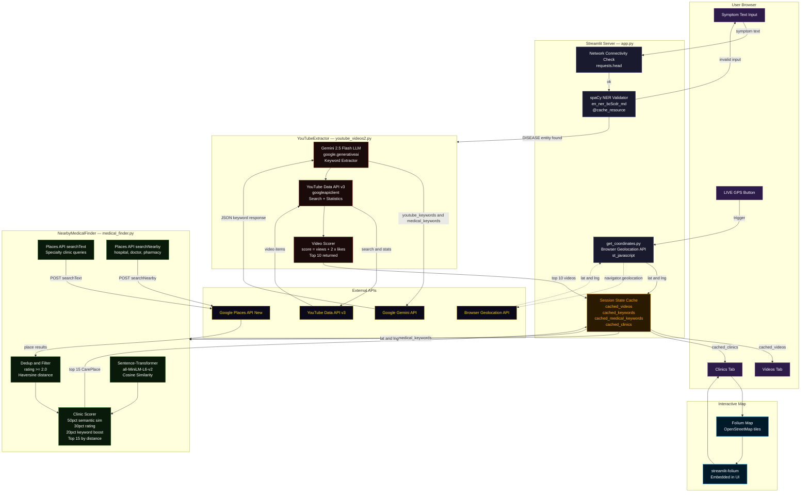
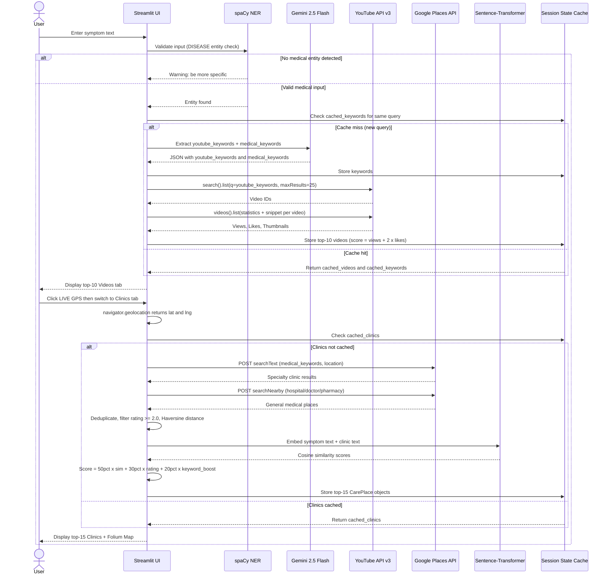
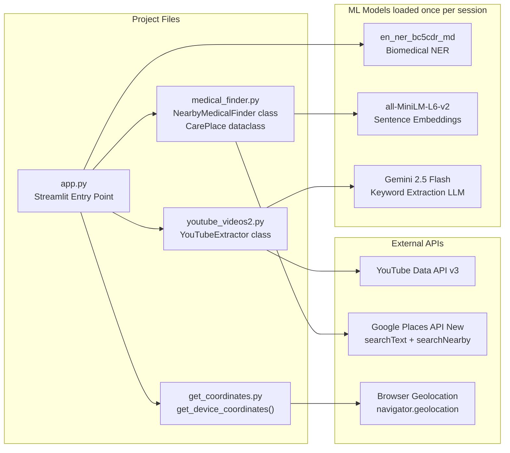
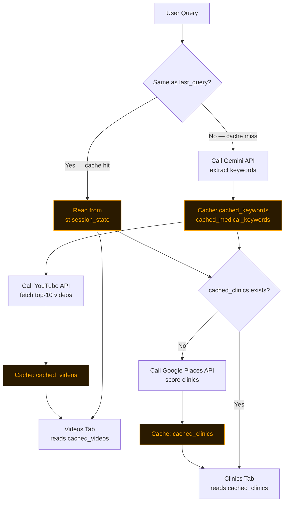
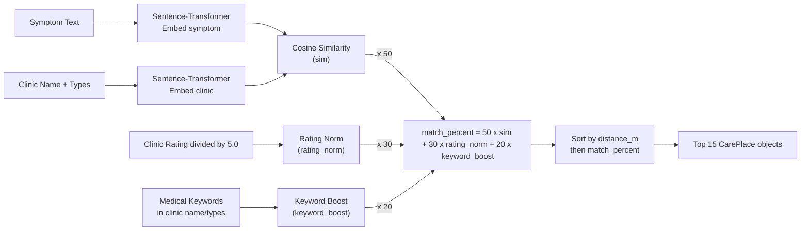

# InfoHealth — Architecture

## Overview

InfoHealth is a **Streamlit-based AI health information system** that bridges the gap between natural language symptom descriptions and structured medical information retrieval. It provides two core services:

1. **Top-10 relevant YouTube videos** for a given symptom description.
2. **Top-15 nearby clinics** ranked by distance and semantic relevance.

---

## System Architecture

---

## Data Flow — Step by Step

---

## Module Breakdown

---

## Caching Strategy

---

## Clinic Scoring Formula

---

## Component Summary

| Component | File | Role | Key Tech |
|-----------|------|------|----------|
| **Streamlit UI** | `app.py` | Entry point, session state, routing, rendering | `streamlit`, custom CSS, `folium` |
| **NER Validator** | `app.py` | Ensures input contains a medical entity | `spacy` — `en_ner_bc5cdr_md` |
| **Keyword Extractor** | `youtube_videos2.py` | LLM call → dual keyword lists | `google.generativeai` (Gemini 2.5 Flash) |
| **Video Retriever** | `youtube_videos2.py` | Search + rank top-10 videos | `googleapiclient` — YouTube Data API v3 |
| **Clinic Finder** | `medical_finder.py` | Fetch, filter, deduplicate, score clinics | `requests` — Google Places API (New) |
| **Semantic Scorer** | `medical_finder.py` | Embed text, cosine similarity for relevance | `sentence_transformers` — MiniLM-L6-v2 |
| **GPS Module** | `get_coordinates.py` | Retrieve browser geolocation via JS | `streamlit_javascript`, `navigator.geolocation` |
| **Map Renderer** | `app.py` | Interactive clinic + user position map | `folium`, `streamlit_folium` |

---

## Diagram Legend

| Symbol | Meaning |
|--------|---------|
| **Solid arrows** `-->` | Synchronous data flow |
| **Dashed arrows** `-.->` | Asynchronous / browser-side calls |
| 🟡 **Gold nodes** | Session-state caching layers |
| 🔴 **Red nodes** | YouTube pipeline |
| 🟢 **Green nodes** | Medical / clinic pipeline |
| 🔵 **Blue nodes** | Map rendering |
| 🟣 **Purple nodes** | User-facing UI elements |
