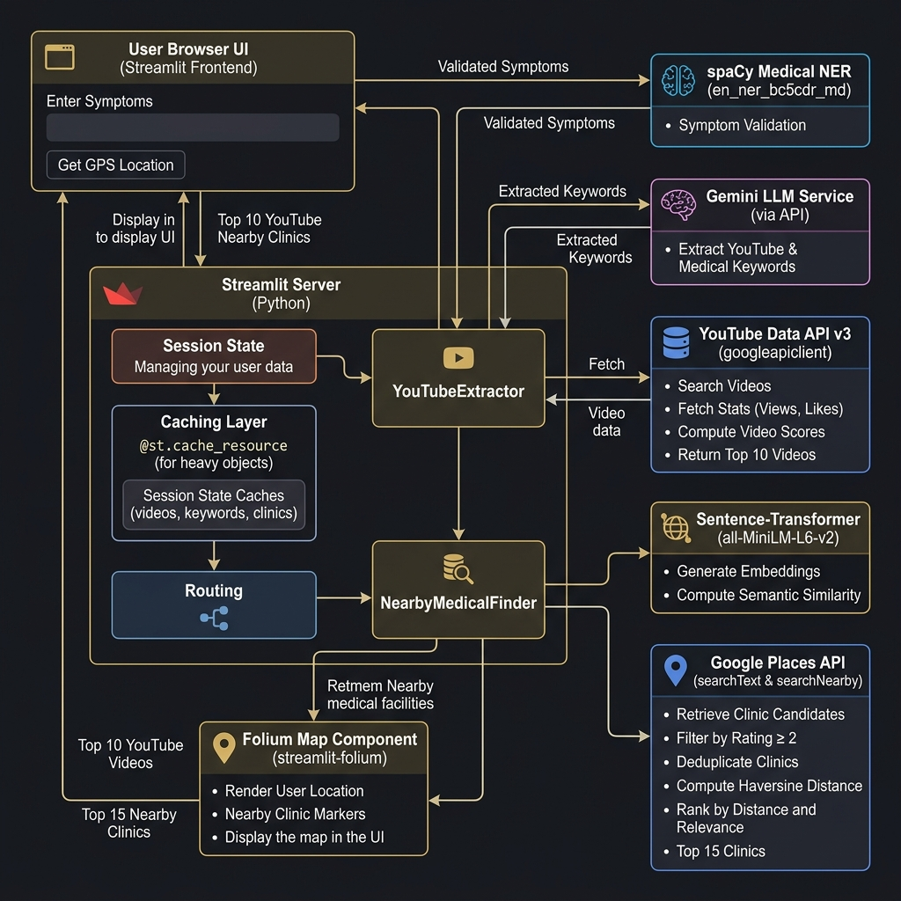

# InfoHealth Application Architecture

## Overview
The InfoHealth app is a **Streamlit‑based web application** that provides two main services:
1. **Top‑10 relevant YouTube videos** for a given symptom description.
2. **Top‑15 relevant nearby clinics** based on the same symptom text.

## Primary Components
| Component | Role | Key Technologies |
|-----------|------|-------------------|
| **User Interface (Streamlit Front‑end)** | Symptom input, GPS button, tab navigation, video & clinic rendering. | Streamlit, custom CSS, Folium (map), `streamlit‑folium`. |
| **Streamlit Server (Python)** | Handles session state, caching, routing, orchestrates downstream services. | `st.session_state`, `@st.cache_resource`, Python 3.11. |
| **Gemini LLM (Gemini‑2.5‑flash)** | Extracts *YouTube‑keywords* and *medical‑keywords* from the free‑text symptom description. | `google.generativeai`. |
| **YouTube Data API v3** | Searches videos, fetches statistics, computes a simple relevance **score = views + 2·likes** and returns the top 10 results. | `googleapiclient.discovery`. |
| **Sentence‑Transformer (all‑MiniLM‑L6‑v2)** | Generates dense embeddings for symptom text and clinic description to compute cosine similarity. | `sentence_transformers`. |
| **Google Places API** (searchText & searchNearby) | Retrieves candidate clinics, filters by rating ≥ 2, deduplicates, computes haversine distance, ranks by distance + relevance (rating, keyword boost, semantic similarity) and returns top 15. | `requests`. |
| **spaCy NER model (en_ner_bc5cdr_md)** | Validates that the user input contains at least one medical entity before any API call. | `spacy`. |
| **Folium Map** | Visualises clinic locations and the user’s GPS position on an interactive map. | `folium`, `streamlit_folium`. |

## Data Flow & Caching
1. **User enters symptoms → Streamlit** validates with **spaCy**.
2. If valid, Streamlit calls **Gemini** (keyword extraction).
3. Extracted keywords are cached in `st.session_state` (`cached_keywords`, `cached_medical_keywords`).
4. **YouTubeExtractor** uses the YouTube keywords to query the **YouTube API** → top‑10 videos are cached (`cached_videos`).
5. **NearbyMedicalFinder** uses the medical keywords, the sentence‑transformer model, and the **Places API** → top‑15 clinics are cached (`cached_clinics`).
6. Subsequent identical queries hit the **session‑state caches**, saving API quota.
7. Heavy objects (spaCy model, Gemini client, Places client) are loaded once per app session via `@st.cache_resource`.

## Diagram Legend
- **Solid arrows** – synchronous data flow.
- **Dashed arrows** – cached retrieval (no external request).
- **Gold accents** – caching layers.
- **Dark‑mode background** – the Streamlit UI theme.

The diagram above visualises all components, their interactions, and the caching strategy.
