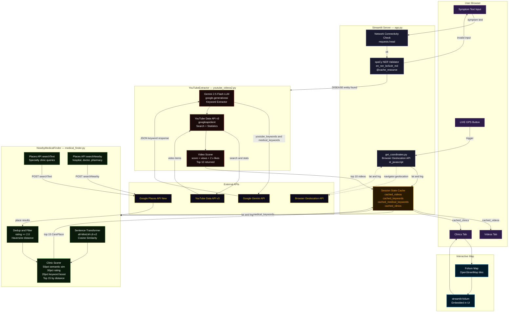

# InfoHealth-AI-powered-medication-recommender
InfoHealth is an AI-powered health information system that extracts medical entities from user symptoms, matches them with reliable sources, and recommends relevant medications and videos with a confidence-based similarity score.

## 🚀 Live Demo & Project Showcase

🔗 **Live Application (Streamlit Deployment)**  
👉 **[Access the InfoHealth App](https://infohealth-ai-powered-med-recommender-atmajo.streamlit.app/)**  
Experience the complete InfoHealth system live, including symptom input, AI-powered keyword refinement, and medical resource recommendations.

🎥 **Project Presentation (Must-Watch | 1 Minute)**  
⭐ **[Watch the AI-Generated Presentation Video](https://youtu.be/M91axJi6AJE?si=RUXKJRsw7Fo3TJ6j)** ⭐  
This short video is the **official project walkthrough**, created from the Google Slides presentation.  
📌 *Highly recommended for recruiters and evaluators to quickly understand the project’s motivation, architecture, and outcomes.*

🧪 **Hands-on Demonstration Video**  
▶️ **[Watch the Practical Demo](https://youtu.be/pUirCVp8oJA?si=QmmHyfWyjON6DIgg)**  
A real-time demonstration showcasing how users interact with the application and how recommendations are generated.

---

---
## System Architecture



---

### 👀 For Readers
If you are short on time, we strongly recommend watching the **1-minute presentation video first**, followed by the **live application demo**, to get a complete understanding of the project in under **3 minutes**.

## **📸 APPLICATION SCREENSHOTS**

### How it opens up 😊

### Videos have been retrieved 😊

### Process of Clinics retrieval going on 😊

### Clinics have been retrieved 😊

### See on map how far are you from each of the clinics 😊


# What made us think about Info-Health? 🩺

Modern information platforms such as **YouTube** and **map-based services** deliver highly relevant results when users provide **precise and well-defined keywords**. However, in medical contexts, this requirement introduces a significant **usability gap** ⚠️. Most users do not have a medical background and are often unfamiliar with the correct **clinical terminology** needed to describe their symptoms accurately.

🗣️ While users may struggle to name probable diseases or formal symptom terms, they are generally capable of expressing their **physical discomfort, pain intensity, and affected body parts** in simple, natural English. This creates an opportunity for **Artificial Intelligence (AI)** to function as an **intelligent intermediary** between human language and structured information retrieval systems.

🔍 In **InfoHealth**, the **Large Language Model (LLM)** bridges this gap by converting **human-expressed symptom descriptions** into **context-aware, platform-relevant keywords**. Instead of forcing users to search using **medical jargon**, the system allows them to describe their condition naturally. The LLM then assists in identifying the **most probable medical concepts** and refining them into keywords suitable for **educational video retrieval** and **location-based clinic searches**.

📊 From an evaluation perspective, the effectiveness of the **LLM** is assessed based on its ability to **improve the relevance and usefulness of retrieved results**. Compared to direct keyword-based searches, **LLM-refined queries** consistently produce more **focused and meaningful recommendations**, improving alignment between **user intent** and retrieved medical content.

🌍 By integrating **AI** with two of the most **trusted and widely used platforms**—**video-based information systems** and **map-based location services**—**InfoHealth** enhances both **accessibility and reliability** in healthcare information discovery. This approach prioritizes **speed, relevance, and clarity**, which are critical in **medical decision-support scenarios**. Importantly, the system does **not replace medical professionals** 🚑 but instead **empowers users** to seek accurate information and appropriate care more efficiently.

## 📁 Project Structure

```text
InfoHealth/
│
├── requirements.txt           # Project dependencies
├── app.py                     # Main application entry point
├── medical_finder.py          # Medical entity extraction and processing logic
├── youtube_videos2.py         # YouTube video retrieval based on refined keywords
├── secrets.toml               # API keys and sensitive configuration (gitignored)
│
├── .gitignore                 # Excludes secrets.toml and other sensitive files
└── README.md                  # Project documentation
```
```text
For Testing we have attached two notebooks and a Reports markdown file:
├── MedicationRecommender.ipynb
├── sciSpacy_usage.ipynb
├── Reports.md
```

## 📜 **License**

This project is open-source and available under the MIT License.

_Made with love by **Atmajo Burman** ❤️_

